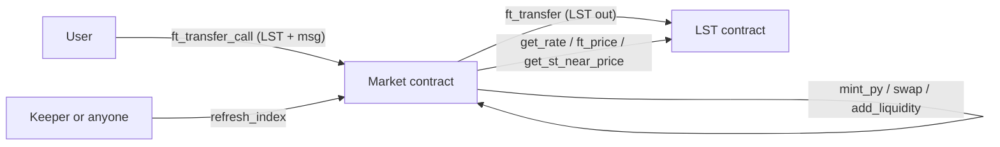

# Exodus on NEAR

> **Fixed yield and yield trading for NEAR liquid staking tokens.**
> Exodus splits a yield-bearing LST into a **Principal Token (PT)**, a zero-coupon bond that redeems for 1 NEAR worth of LST at maturity, and a **Yield Token (YT)**, which collects the staking yield of that 1 NEAR until maturity. PT is traded against the LST in an on-chain AMM that ports the **Pendle V2 logit curve** to Rust.

[](https://github.com/ayoubbuoya/exodus-near/actions/workflows/ci.yml)
[](LICENSE)
[](https://crates.io/crates/near-sdk)

**Hackathon:** NEAR Hackathon (deadline 14 Nov 2026, 23:59 UTC), DeFi track.
**Status:** Hackathon prototype. **Unaudited. Testnet only.**

---

## Contents

1. [The idea in one minute](#1-the-idea-in-one-minute)
2. [Live on testnet](#2-live-on-testnet)
3. [Verify it yourself (≈5 minutes)](#3-verify-it-yourself-5-minutes)
4. [What is real vs. demo](#4-what-is-real-vs-demo)
5. [How it works](#5-how-it-works)
6. [Repository layout](#6-repository-layout)
7. [Known limitations](#7-known-limitations)
8. [License](#8-license)

---

## 1. The idea in one minute

Staking yield on NEAR LSTs is **variable**. That is a problem for two kinds of users:

- **Savers, DAOs and treasuries** want a rate they can plan around.
- **Yield traders** want exposure to staking yield without buying all of the principal.

Exodus serves both by splitting the LST:

| Token | What you hold | Who wants it |
| :--- | :--- | :--- |
| **PT** | Redeems for 1 NEAR worth of LST at maturity. Bought at a discount today, so the discount is your **fixed yield**. | Savers |
| **YT** | Receives all staking yield on 1 NEAR of principal until maturity. Costs a fraction of 1 NEAR, so it is a leveraged bet on the yield. | Yield traders |

Depositing LST mints **equal amounts of PT and YT**, one of each per 1 NEAR of value (`LST × index`). Returning equal PT + YT gives the LST back at any time, so the two halves always add back up to the original deposit.

---

## 2. Live on testnet

| Account | What it is | Explorer |
| :--- | :--- | :--- |
| `demo-market.fond-buoya.testnet` | Market on **MockLST** (PT token + YT ledger + AMM), expiry 31 Mar 2027 | [NearBlocks](https://testnet.nearblocks.io/address/demo-market.fond-buoya.testnet) |
| `mock-lst.fond-buoya.testnet` | Demo LST with a public faucet and an owner-controlled exchange rate | [NearBlocks](https://testnet.nearblocks.io/address/mock-lst.fond-buoya.testnet) |
| `linear-market.fond-buoya.testnet` | Market on **real testnet LiNEAR**, expiry 31 Mar 2027 | [NearBlocks](https://testnet.nearblocks.io/address/linear-market.fond-buoya.testnet) |
| `linear-protocol.testnet` | LiNEAR staking contract (third party, not ours) | [NearBlocks](https://testnet.nearblocks.io/address/linear-protocol.testnet) |
| `fond-buoya.testnet` | Deployer / owner account | [NearBlocks](https://testnet.nearblocks.io/address/fond-buoya.testnet) |

Both market accounts run the same compiled contract. Backend API: `https://api-exodus-near.buoya.space`.

---

## 3. Verify it yourself (≈5 minutes)

### A. Run all Rust tests

```bash
cargo test --workspace
```

Expected: **39 tests pass** across 6 test binaries.

| Package | Tests | What they check |
| :--- | :---: | :--- |
| `exodus-math` (unit) | 12 | Fixed-point mul/div rounding, `ln`/`exp`, rate scalar, YT interest, PT/YT minting, liquidity and YT swap math |
| `exodus-math` (`tests/vector_tests.rs`) | 1 | Rust output matches vectors produced by the Python reference model (`scripts/reference_math.py` → `scripts/test_vectors.json`) |
| `market` | 8 | Init, `mint_py` via `ft_transfer_call`, stale-index and pause rejection, YT transfer accrual, interest claim, YT buy/sell, add → swap → remove liquidity |
| `mock-lst` | 9 | Faucet + cooldown, rate can only increase, owner-only mint/rate, transfers |
| `sandbox-tests` | 5 | Multi-step scenarios across both contracts (see note below) |
| `backend` | 4 | Health and markets endpoints, implied-rate helper, and **one test that calls the public testnet RPC** (it is skipped silently if the RPC is unreachable) |

> **Note on `sandbox-tests`:** despite the crate name, these tests use the `near-sdk` **unit-testing mock environment** (`testing_env!`), not a real `near-sandbox` node. They run the real contract code through full lifecycles (mint → rate increase → interest → maturity → redeem, and the AMM lifecycle), but cross-contract promises and callbacks are **not** executed. See [Known limitations](#7-known-limitations).

### B. Read the live market state

```bash
# Market state: index, reserves, implied rate, paused flag, ...
near contract call-function as-read-only demo-market.fond-buoya.testnet get_market json-args '{}' network-config testnet now

# MockLST exchange rate (1e24 = 1.0 NEAR per LST)
near contract call-function as-read-only mock-lst.fond-buoya.testnet get_rate json-args '{}' network-config testnet now
```

### C. Run the web app

Requires Node 22.18+ (Node 24 recommended).

```bash
cd frontend
npm install
npm run dev        # http://localhost:5173
npm test           # frontend unit tests
```

In the app:

1. Click **"Take the quick tour"** for a guided walkthrough.
2. Tabs: **Fixed yield** (buy PT), **Long yield** (buy YT), **Liquidity**, **Mint & redeem**, **Portfolio**, **Cross-chain**.
3. On the demo market, use the MockLST faucet (100 mLST per claim, 60 s cooldown) to get test funds.
4. **Cross-chain** tab: pick an asset (for example USDC on Arbitrum or Base) and request a quote. It calls NEAR Intents 1Click in **"Preview only"** mode (a dry quote, nothing is sent). Numbers come from the live 1Click API and change over time.

### D. Make yield happen on testnet (owner only)

Real staking yield moves slowly. On the **demo** market, the owner can bump the MockLST rate and refresh the index to show interest accruing:

```powershell
.\scripts\demo_advance.ps1 -IncreasePercent 1.0
```

```bash
./scripts/demo_advance.sh fond-buoya.testnet 1
```

This needs the `fond-buoya.testnet` keys, so judges can read it but not run it against our deployment. To run the full flow yourself, deploy your own copy with `scripts/deploy_testnet.ps1` / `.sh` and your own testnet account.

---

## 4. What is real vs. demo

| Area | Status |
| :--- | :--- |
| Market contract (PT, YT, AMM, redeem, claim) | **Real**, deployed on testnet |
| LiNEAR market | **Real** testnet LiNEAR as the underlying, index read from `linear-protocol.testnet` (`ft_price`) |
| MockLST market | **Demo**: the exchange rate is set by the owner, to show yield without waiting weeks |
| stNEAR (Meta Pool) | Supported **in code** (`RateSource::MetaPool` reads `get_st_near_price`) but **no market is deployed** |
| Backend keeper | **Real code**: calls `refresh_index` when the epoch changes, if `KEEPER_ACCOUNT_ID` / `KEEPER_PRIVATE_KEY` are set |
| Cross-chain (1Click) | **Quote preview only** in the UI. No cross-chain deposit is executed by the demo |

---

## 5. How it works

### One market = one contract

Each market contract does three jobs:

- It **is** the PT token: NEP-141 (fungible token), NEP-145 (storage deposit) and NEP-148 (metadata).
- It keeps an **internal YT ledger** (`yt_balance_of`, `yt_transfer`) with per-user interest accrual.
- It runs the **PT/LST AMM** and LP accounting.

Because PT, YT and the pool live in one contract, a swap (including the YT swaps, which flash-mint or flash-redeem PT+YT inside the same call) finishes within a single function call. No cross-contract hops in the middle of a trade.



### Main entry points

| Action | How | Paused? |
| :--- | :--- | :--- |
| Mint PT + YT | `ft_transfer_call` with `{"action":"mint_py"}` | Blocked |
| Buy PT / buy YT | `ft_transfer_call` with `swap_exact_sy_for_pt` / `swap_exact_sy_for_yt` | Blocked |
| Add liquidity | `ft_transfer_call` with `add_liquidity` | Blocked |
| Sell PT / sell YT | `swap_exact_pt_for_sy`, `swap_exact_yt_for_sy` | Blocked |
| Redeem PT + YT before maturity | `redeem_py` | **Always allowed** |
| Redeem PT after maturity | `redeem_pt` | **Always allowed** |
| Claim YT interest | `claim_interest` | **Always allowed** |
| Remove liquidity | `remove_liquidity` | **Always allowed** |

The owner's `pause()` only stops **new risk** and never blocks exits. One nuance: `redeem_py` (and the risk-taking actions) also require the exchange-rate index to be fresh for the current epoch (`INDEX_STALE: call refresh_index`). `refresh_index` is **public**, so any user can unblock themselves.

### Events

All state changes emit NEP-297 `EVENT_JSON` logs with `standard: "exodus"`, `version: "1.0.0"`: `mint_py`, `redeem_py`, `redeem_pt`, `claim_interest`, `swap`, `add_liquidity`, `remove_liquidity`, `index_updated`, `market_matured`, `paused`, `unpaused`. (The backend indexer does not parse these yet. It polls market state over RPC and stores APY snapshots.)

### Fees (contract defaults)

- **3%** of YT yield goes to the treasury (owner-configurable, max 10%).
- AMM trade fee root `ln(1.001)` (~0.1% annualized), with **20%** of trade fees sent to the treasury.

### Math (`crates/exodus-math`)

- Pure Rust, **no dependencies**, no floats. 18-decimal fixed point (`FP_ONE = 1e18`) with 256-bit intermediate products.
- `ln` / `exp` via series expansion, based on Balancer's `LogExpMath` approach.
- Rounding always favours the protocol (minted amounts and amounts paid out round down, amounts owed round up).
- Checked against a Python reference model (`scripts/reference_math.py`).

Logit curve, as implemented in `market.rs`:

```math
\tau = \text{expiry} - \text{now}, \qquad \text{rate\_scalar} = \text{scalar\_root} \cdot \frac{\text{YEAR}}{\tau}
```

```math
p = \frac{\text{total\_pt}}{\text{total\_pt} + \text{total\_sy} \cdot \text{index}}
```

```math
\text{ExchangeRate}(p) = \frac{\ln\left(\frac{p}{1-p}\right)}{\text{rate\_scalar}} + \text{rate\_anchor}, \qquad \text{PT price} = \frac{1}{\text{ExchangeRate}}
```

The `rate_anchor` is recomputed before each trade so the implied rate stays continuous between trades. As maturity approaches, `rate_scalar` grows, so the curve flattens and the PT price converges to 1. This reduces (but does not remove) impermanent loss for LPs compared with a constant-product pool. Exact-input swaps are solved with a bounded 64-step binary search.

---

## 6. Repository layout

```text
exodus-near/
├── contracts/
│   ├── market/        # PT (NEP-141/145/148) + YT ledger + logit AMM + index refresh
│   └── mock-lst/      # Demo LST: faucet, owner-set monotonic exchange rate
├── crates/
│   └── exodus-math/   # Fixed-point, ln/exp, tokenization, interest, AMM math
├── tests/
│   └── sandbox/       # Multi-contract scenario tests (near-sdk mock environment)
├── backend/           # Rust axum API + PostgreSQL (sqlx) indexer + keeper + 1Click proxy
├── frontend/          # React 19 + Vite + TypeScript + Tailwind CSS v4 + @hot-labs/near-connect
├── scripts/           # Testnet deploy, demo yield advance, Python reference math
├── deploy/            # Docker Compose + nginx for the backend VPS
└── .github/workflows/ # CI: cargo test --workspace
```

Build a contract to WASM:

```bash
cargo near build non-reproducible-wasm --no-abi --manifest-path contracts/market/Cargo.toml
```

---

## 7. Known limitations

- **Unaudited.** Do not use with real funds.
- **No real-node integration tests yet.** `tests/sandbox` uses the `near-sdk` mock environment. Cross-contract flows (`ft_transfer_call` → `ft_on_transfer` refunds, `refresh_index` callbacks, failed `ft_transfer` handling) are covered by code paths and manual testnet use, not by an automated `near-sandbox` test.
- **Keeper key scope is not enforced by the code.** The backend signs with whatever key is in `KEEPER_PRIVATE_KEY`. Best practice is a function-call access key limited to `refresh_index` on the market, but you have to create that key yourself.
- **Owner powers.** The owner can pause new risk-taking, change the treasury and change the interest fee (capped at 10%). On the demo market the owner also controls the MockLST rate.
- **Cross-chain flow is preview only** in the demo UI.
- **One maturity per market**, and markets are deployed manually (no factory).

---

## 8. License

[MIT](LICENSE) © 2026 Ayoub
