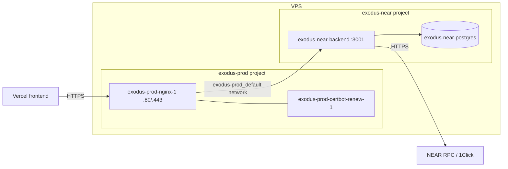

# VPS Backend Deployment (api-exodus-near.buoya.space)

Deploys only the Rust backend (plus its own PostgreSQL) to the VPS that already
runs the `exodus-prod` compose project (nginx + certbot). The frontend stays on Vercel.

## Architecture



- `exodus-near-backend` joins the existing `exodus-prod_default` network so nginx can reach it by name.
- `exodus-near-postgres` is only on the private `internal` network, with no published port.
- Nothing in the `exodus-prod` compose file changes. Only one nginx config file is added.

## Files

| File | Purpose |
|---|---|
| `backend/Dockerfile` | Multi-stage build of the `backend` binary (build context = repo root) |
| `.dockerignore` | Keeps `target/`, `frontend/`, `.git`, `.env` out of the build |
| `deploy/docker-compose.yml` | `backend` + `postgres` services, project name `exodus-near` |
| `deploy/.env.example` | Committed template for `deploy/.env` on the server |
| `deploy/.env.prod.example` | **Git-ignored**, ready-to-use prod values (generated DB password). Copied to the server as `deploy/.env` |
| `deploy/nginx/api-exodus-near.buoya.space.bootstrap.conf` | HTTP-only config used to get the first certificate |
| `deploy/nginx/api-exodus-near.buoya.space.conf` | Final HTTP→HTTPS + reverse-proxy config |

## Step 0: Find how the existing nginx and certbot are wired

The nginx image is custom (`exodus-prod-proxy`), so first check where its config
and certificates live:

```bash
docker inspect exodus-prod-nginx-1 --format '{{range .Mounts}}{{.Source}} -> {{.Destination}}{{println}}{{end}}'
docker inspect exodus-prod-certbot-renew-1 --format '{{range .Mounts}}{{.Source}} -> {{.Destination}}{{println}}{{end}}'
docker exec exodus-prod-nginx-1 nginx -T 2>/dev/null | grep -nE "include|acme-challenge|root "
```

Write down:

1. **Config dir:** the host folder mounted to `/etc/nginx/conf.d` (or whatever `include` uses).
   If there is **no mount**, the config is baked into the image. In that case add the
   file to the `exodus-prod` repo's nginx folder and rebuild that image instead of copying it.
2. **Webroot:** the folder certbot writes challenges to (usually `/var/www/certbot`).
   If it differs, edit the `root` line in both nginx files.
3. **Letsencrypt dir:** usually `/etc/letsencrypt`, shared by nginx and certbot.

## Step 1: DNS

Create an `A` record: `api-exodus-near.buoya.space` → the VPS public IP (the EC2 Elastic IP).
Check it with `dig +short api-exodus-near.buoya.space`.
Ports 80/443 are already open because the existing site works.

## Step 2: Code and secrets

```bash
git clone <repo-url> ~/exodus-near && cd ~/exodus-near
```

`deploy/.env.prod.example` is git-ignored (it holds real secrets), so `git clone`
does not bring it. Copy it from your PC (run this **on your PC**):

```bash
scp deploy/.env.prod.example ubuntu@<vps-ip>:~/exodus-near/deploy/.env
```

Then lock it down **on the server**:

```bash
chmod 600 ~/exodus-near/deploy/.env
```

(No prod file? Use `cp deploy/.env.example deploy/.env`, put `openssl rand -hex 24`
in `POSTGRES_PASSWORD`, and fill in the rest.)

## Step 3: Start the backend

```bash
docker compose -f deploy/docker-compose.yml up -d --build
docker compose -f deploy/docker-compose.yml logs -f backend
```

Expect `Connected to PostgreSQL` and `Exodus Backend listening on http://0.0.0.0:3001`.
The first build compiles the workspace in release mode and takes a few minutes.

Check that nginx can see it:

```bash
docker exec exodus-prod-nginx-1 wget -qO- http://exodus-near-backend:3001/health
```

## Step 4: Certificate (two passes)

1. Copy `deploy/nginx/api-exodus-near.buoya.space.bootstrap.conf` into the nginx config dir (Step 0),
   then test and reload:
   ```bash
   docker exec exodus-prod-nginx-1 nginx -t && docker exec exodus-prod-nginx-1 nginx -s reload
   ```
2. Issue the certificate with the certbot image, reusing the existing volumes:
   ```bash
   docker run --rm \
     --volumes-from exodus-prod-certbot-renew-1 \
     --entrypoint certbot certbot/certbot certonly --webroot -w /var/www/certbot \
     -d api-exodus-near.buoya.space --agree-tos -m <your-email> --no-eff-email
   ```
3. Replace the bootstrap file with `deploy/nginx/api-exodus-near.buoya.space.conf` (delete the bootstrap
   file, or both define the same `server_name` on port 80), then run `nginx -t` and reload again.

The existing `certbot-renew` container renews every cert under `/etc/letsencrypt`,
including this one, because the final config still serves `/.well-known/acme-challenge/`.

## Step 5: Verify

```bash
curl https://api-exodus-near.buoya.space/health
curl https://api-exodus-near.buoya.space/markets
```

## Step 6: Vercel

Set `VITE_BACKEND_URL=https://api-exodus-near.buoya.space` in the Vercel project environment
variables and redeploy (Vite bakes `VITE_*` values in at build time).

## Updating later

```bash
cd ~/exodus-near && git pull
docker compose -f deploy/docker-compose.yml up -d --build
```

## Notes and risks

- **Keeper is a stub:** `NearRpcClient::call_refresh_index` does not sign or send a
  transaction yet. Leave `KEEPER_*` empty. `refresh_index` must still be called another way.
- **Shared network:** the backend shares `exodus-prod_default` with the other project's
  containers. Don't rename the `backend` service to `api`, `db`, `oracle` or `nginx`, or
  Docker DNS names will collide.
- **No DB backup:** the data can be rebuilt by the indexer from chain state.
- **Pause/unpause:** `docker compose -f deploy/docker-compose.yml down` keeps the
  `pgdata` volume. Add `-v` only to wipe the database.
