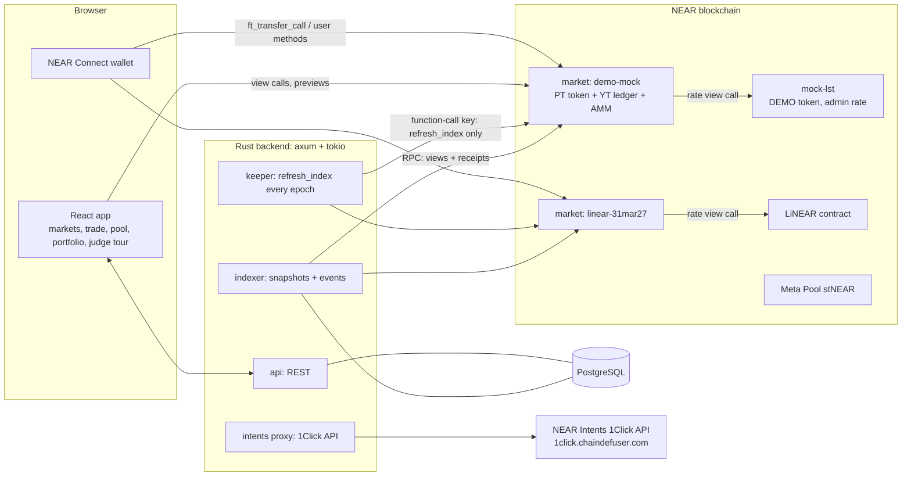
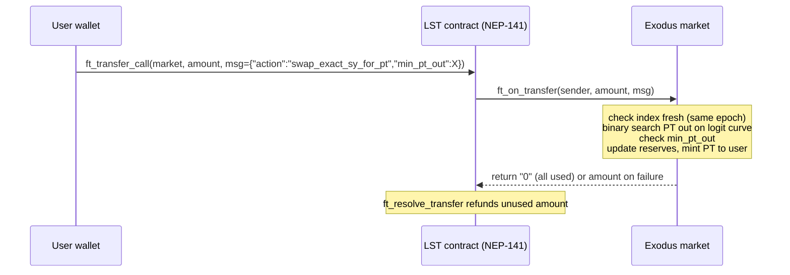
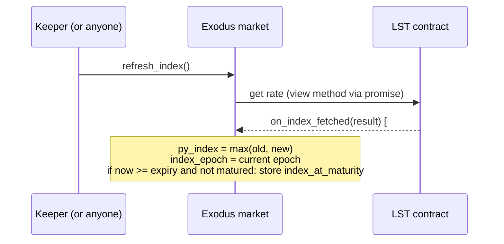

# Exodus on NEAR: Technical Architecture

Version 0.1, 6 Nov 2026. Read `SPEC.md` first (what we build). This file is how we build it.

---

## 1. Principles

1. **One market = one contract.** The market contract holds the LST, is the PT token (NEP-141), keeps the YT ledger and runs the AMM. Everything a trade needs is in one contract, so trades are synchronous: no cross-contract calls in the middle of a swap, no half-done state.
2. **Shared math crate.** `exodus-math` is pure Rust fixed-point code, used by the contract and by the backend. Tested against a Python reference model.
3. **No floats on-chain.** Fixed point with 18 decimals for rates, `i128`/`u128` everywhere, rounding always in favor of the protocol.
4. **Users can always exit.** Pause stops new risk (mint, swap, add liquidity). Redeem, claim and remove liquidity always work.
5. **Small trusted surface.** Owner can pause and tune fees in hard bounds. Owner cannot move user funds. Keeper can only call `refresh_index`.
6. **Secrets never in the repo.** Keys only in environment variables.

---

## 2. System diagram



### Mint and buy-PT flow



### Index refresh flow



---

## 3. Tech stack

Versions checked on **6 Nov 2026** from crates.io and the npm registry. Pin them in `Cargo.lock` / `package-lock.json`. If a release that came out in the last days breaks the build, pin the previous minor and write it in `HANDOFF.md`.

### Smart contracts (Rust)

| Part | Choice | Version | Released | Notes |
| --- | --- | --- | --- | --- |
| Contract SDK | `near-sdk` | 5.30.1 | 5 Nov 2026 | Very fresh. Fallback: previous 5.x minor. |
| Standards | `near-contract-standards` | 5.30.1 | 5 Nov 2026 | NEP-141, NEP-145, NEP-148 helpers for the PT token. |
| Build / deploy | `cargo-near` | 0.23.0 | 6 Nov 2026 | Reproducible builds (`cargo near build reproducible-wasm`). |
| Sandbox tests | `near-sandbox` | 0.4.0 | 26 Oct 2026 | near-workspaces-rs is being replaced by near-api + near-sandbox. |
| Test client | `near-api` | 0.8.7 | 28 Oct 2026 | Also used by the backend. |
| Events | NEP-297 | standard | | `EVENT_JSON:` logs. |

### Backend (Rust)

| Part | Choice | Version | Notes |
| --- | --- | --- | --- |
| HTTP | `axum` | 0.8.9 (14 Apr 2026) | REST only, no WebSocket needed (poll every 10 s). |
| Runtime | `tokio` | 1.54.1 (21 Oct 2026) | |
| DB | `sqlx` + PostgreSQL | 0.9.0 (21 May 2026) | New major version: check the migration notes on setup. |
| NEAR client | `near-api` | 0.8.7 | View calls, keeper transactions, receipt reading. |
| HTTP client | `reqwest` | verify on setup | For the 1Click API. |
| Logs | `tracing` | verify on setup | |
| Math | `exodus-math` | workspace crate | Shared with the contract. |

### Frontend

| Part | Choice | Version | Notes |
| --- | --- | --- | --- |
| Build | Vite | 8.3.6 (5 Nov 2026) | |
| UI | React | 19.3.1 (5 Nov 2026) | |
| Language | TypeScript | latest is 7.0.2 | Use the version the Vite React template pins. TS 7 is a big rewrite, do not force it if the template uses an older one. |
| Wallet | `@hot-labs/near-connect` + `near-connect-hooks` | 0.12.0 / 1.1.6 | NEAR docs recommend NEAR Connect over the old Wallet Selector. |
| RPC / tx building | `near-api-js` | 7.4.0 (23 Oct 2026) | Only if near-connect does not cover a need. |
| Charts | small chart lib, decide on setup | verify | Implied vs underlying APY line chart. |
| Styling | Tailwind or plain CSS | verify | Keep simple. |

### External services

| Service | Use | Status |
| --- | --- | --- |
| NEAR RPC (testnet, mainnet) | All chain access | Use a reliable provider; public RPC has rate limits. |
| NEAR Intents 1Click API | Cross-chain entry | Base `https://1click.chaindefuser.com/v0`. Flow: `GET /tokens` -> `POST /quote` (dry) -> `POST /quote` (real, gives deposit address) -> user deposit -> `POST /deposit/submit` -> `GET /status`. Docs show an `X-API-Key` header; key from https://partners.near-intents.org/. **Mainnet only.** |
| Explorer | Tx links | NearBlocks (testnet and mainnet). |

### LST rate sources (verify on day 1, SPEC Q1, Q2)

| LST | Mainnet contract | Testnet contract | Rate view method (believed) |
| --- | --- | --- | --- |
| stNEAR (Meta Pool) | `meta-pool.near` | `meta-v2.pool.testnet` (verify) | `get_st_near_price` |
| LiNEAR | `linear-protocol.near` | `linear-protocol.testnet` (exists) | `ft_price` |
| MockLST (ours) | none | `mock-lst.<owner>.testnet` | `get_rate` |

Assumption to confirm: these return the NEAR value of 1 LST as a `U128` string with 24 decimals. The contract converts to 18-decimal fixed point. The rate source is an enum in the market config, so adding a new LST means adding one variant.

---

## 4. Repository layout

```
exodus-near/
  README.md                 # for humans and AI judges: what, why, "do X, see Y", prior work
  LICENSE                   # required by the hackathon
  docs/
    overview.md
    SPEC.md
    TECH_architecture.md
    HANDOFF.md
  Cargo.toml                # workspace
  crates/
    exodus-math/            # fixed point, ln/exp, market math, interest math. no_std-friendly, no near-sdk dependency
  contracts/
    market/                 # PT token + YT ledger + AMM + index
    mock-lst/               # DEMO LST with admin-increasable rate
  backend/
    migrations/
    src/
      main.rs
      config.rs
      keeper/               # refresh_index loop
      indexer/              # snapshots + NEP-297 events
      intents/              # 1Click proxy
      api/                  # REST handlers
      db/
  frontend/
    src/
      pages/                # Markets, Market, Portfolio, FromAnotherChain
      components/
      lib/                  # api client, wallet, contract calls, formatting
  tests/
    sandbox/                # near-sandbox integration tests (full lifecycle)
  scripts/
    reference_math.py       # Python reference model, writes test vectors JSON
    deploy_testnet.sh       # build, create sub-accounts, deploy, init, seed liquidity
    demo_advance.sh         # bump MockLST rate, refresh index
```

---

## 5. Market contract design

### 5.1 State

```rust
#[near(contract_state)]
pub struct Market {
    // config
    owner: AccountId,
    treasury: AccountId,
    lst: AccountId,                 // NEP-141 LST contract
    rate_source: RateSource,        // MetaPool | Linear | Mock
    expiry_ns: u64,
    scalar_root: i128,              // 1e18 fixed
    initial_anchor: i128,           // 1e18 fixed
    ln_fee_rate_root: i128,         // 1e18 fixed
    reserve_fee_bps: u16,
    interest_fee_bps: u16,
    tvl_cap_sy: u128,
    paused: bool,

    // index
    py_index: u128,                 // 1e18 fixed, NEAR per LST, never decreases
    index_epoch: u64,
    index_updated_ns: u64,
    index_at_maturity: Option<u128>,

    // PT token (NEP-141 via near-contract-standards FungibleToken)
    pt: FungibleToken,
    pt_metadata: LazyOption<FungibleTokenMetadata>,

    // YT ledger
    yt_balances: LookupMap<AccountId, u128>,
    yt_total_supply: u128,
    user_interest: LookupMap<AccountId, UserInterest>,  // { user_index: u128, accrued_sy: u128 }

    // AMM
    total_pt: u128,                 // PT held by the pool
    total_sy: u128,                 // LST held by the pool
    total_lp: u128,
    lp_balances: LookupMap<AccountId, u128>,
    last_ln_implied_rate: i128,

    // accounting
    sy_reserved_for_interest: u128, // LST owed to YT holders (accrued, not claimed)
    treasury_sy: u128,
    pending_refunds: LookupMap<AccountId, u128>, // LST that failed to transfer out, withdrawable later
}
```

Invariant (checked in tests after every operation):
```
LST balance of contract >= total_sy (pool)
                         + (pt_total_supply_outside_pool + yt-backed principal) / py_index   (principal backing)
                         + sy_reserved_for_interest + treasury_sy + sum(pending_refunds)
```
In plain words: the contract always holds enough LST to pay every PT, every YT interest claim, the pool and the treasury.

### 5.2 Async patterns (NEAR specifics)

- **Incoming LST:** only through `ft_transfer_call`. `ft_on_transfer` returns the unused amount as `U128`; on any error it returns the full amount, so the LST contract refunds the user. Never panic after changing state in `ft_on_transfer`; validate first, then change state.
- **Outgoing LST:** deduct from internal state first, then `ft_transfer` with 1 yocto, then a `#[private]` callback. If the transfer failed, credit `pending_refunds[user]`. User calls `withdraw_pending()` later. Never re-credit to the original ledger (keeps accounting simple).
- **Storage:** PT uses NEP-145 `storage_deposit`. The market also needs to be registered on the LST contract (`storage_deposit` on the LST at deploy time) and users must be registered on the LST to receive it (frontend checks `storage_balance_of` and adds a `storage_deposit` action when needed).
- **Index read:** promise to the LST view method plus a `#[private]` callback `on_index_fetched`. Parse failure or a lower value never decreases `py_index`.
- **Gas:** binary search swaps must stay under 100 Tgas. Benchmark in sandbox tests and record the result in `HANDOFF.md`.

### 5.3 Rounding rules

| Operation | Rounds |
| --- | --- |
| PT/YT minted | down |
| SY out on redeem, swap, claim | down |
| SY in required (exact-out) | up |
| Interest accrued | down |
| LP minted | down, LP burned: up |

Max allowed loss per operation for a user: 1 smallest unit (1e-24 LST). Any dust stays in the contract and goes to the treasury.

### 5.4 Market parameters (starting values, tune in the Python model, SPEC Q3)

| Param | Start value | Meaning |
| --- | --- | --- |
| `scalar_root` | to tune, start near Pendle LST markets | Curve steepness. Higher = flatter = deeper liquidity in a narrow APY range. |
| `initial_anchor` | `exp(ln(1 + 0.08) * tau / YEAR)` style value for ~8% | Starting implied rate. |
| `ln_fee_rate_root` | `ln(1.001)` | ~0.1% annualized fee on the rate. |
| `reserve_fee_bps` | 2000 | 20% of swap fees to treasury, rest to LPs. |
| `interest_fee_bps` | 300 | 3% of YT interest to treasury. |
| `tvl_cap_sy` | testnet: none, mainnet: 50 NEAR worth | Safety. |

### 5.5 MockLST contract

- NEP-141 with `mint(account, amount)` for the owner (demo faucet: anyone can call `faucet()` for a fixed small amount, rate limited per account).
- `get_rate() -> U128` (24 decimals). `set_rate(new)` owner-only, must be `>= current`.
- Name and symbol include "DEMO".

---

## 6. Backend

### 6.1 keeper
- Every 30 minutes, and when `epoch_height` changes: for each market where `index_epoch < current epoch` or near expiry, call `refresh_index`.
- Uses an account whose key is a **function-call access key** restricted to the market contracts and method `refresh_index`, with a small allowance. One key per market (a function-call key is bound to one receiver).
- Logs every call with tx hash.

### 6.2 indexer
- Every 60 seconds: call `get_market()` on each market, write a row to `market_snapshots`.
- Read new blocks/receipts for the market accounts and parse `EVENT_JSON:` logs into `events` (idempotent by receipt id + log index). Simplest MVP: poll NearBlocks API or RPC `EXPERIMENTAL_changes`; choose on day 1 by what is reliable on testnet.
- Computes underlying APY from snapshots: `(I_now / I_7d)^(365 / 7) - 1`, with a shorter window if less history exists (labeled).

### 6.3 intents proxy
- Keeps the 1Click API key on the server.
- `GET /intents/tokens` (cached 10 min), `POST /intents/quote` (dry or real), `POST /intents/submit`, `GET /intents/status/:deposit_address`.
- Rate limit per IP. Never handles user funds or keys.

### 6.4 api (REST)
- `GET /markets` list with latest snapshot
- `GET /markets/:id` details
- `GET /markets/:id/history?window=24h|7d|30d` implied APY, underlying APY, TVL series
- `GET /markets/:id/trades?limit=50`
- `GET /users/:account/positions` (from events + live views)
- `GET /health`
- intents routes above

### 6.5 Data model (PostgreSQL)

```sql
markets          (id TEXT PK, contract_id TEXT UNIQUE, lst TEXT, network TEXT, expiry TIMESTAMPTZ,
                  is_demo BOOL, created_at TIMESTAMPTZ)
market_snapshots (market_id FK, ts TIMESTAMPTZ, py_index NUMERIC, implied_apy NUMERIC,
                  total_pt NUMERIC, total_sy NUMERIC, total_lp NUMERIC, tvl_near NUMERIC,
                  PRIMARY KEY (market_id, ts))
events           (receipt_id TEXT, log_index INT, market_id FK, block_height BIGINT, ts TIMESTAMPTZ,
                  kind TEXT, account_id TEXT, data JSONB, PRIMARY KEY (receipt_id, log_index))
keeper_runs      (id BIGSERIAL PK, market_id FK, ts TIMESTAMPTZ, tx_hash TEXT, ok BOOL, error TEXT)
intents_quotes   (deposit_address TEXT PK, ts TIMESTAMPTZ, origin_asset TEXT, dest_asset TEXT,
                  amount_in NUMERIC, status TEXT, last_checked TIMESTAMPTZ)
```

---

## 7. Frontend

- Pages: `/` markets list, `/market/:id` (tabs Fix, Long yield, Pool, Mint/Redeem), `/portfolio`, `/bridge` (From another chain), judge tour overlay on all pages.
- Trade forms call contract **view previews** while typing (debounced), so numbers come from the same math as execution.
- Transactions:
  - LST-in actions: one transaction to the LST contract with `ft_transfer_call` (plus `storage_deposit` actions if needed, batched).
  - Other actions: one function call to the market with 1 yocto.
  - If `index_epoch` is stale, the UI first sends `refresh_index` and waits for the callback before the user action.
- Show explorer links after every transaction. Show testnet/mainnet and DEMO badges.

---

## 8. Testing

| Layer | What | Tool |
| --- | --- | --- |
| Math | ln/exp accuracy vs Python (relative error < 1e-12), market math vs Python test vectors, interest math | `cargo test -p exodus-math` |
| Math properties | mint then redeem never creates value; buy then sell PT never profits; implied rate moves the right way after a trade; `ER >= 1` | proptest (verify crate version) |
| Contract unit | each method, every error path, admin checks, pause rules | `cargo test -p market` |
| Sandbox integration | full lifecycle with MockLST: deploy, seed LP, mint, buy PT, buy YT, bump rate, refresh, claim, pass expiry, redeem PT, remove LP, collect treasury; LST invariant after each step; gas per method recorded | near-sandbox 0.4.0 + near-api 0.8.7 |
| Failure paths | stale index, slippage fail, transfer-out failure goes to `pending_refunds`, paused market still allows exit | sandbox |
| Backend | snapshot math, event parsing, intents proxy with mocked 1Click | `cargo test -p backend` |
| End to end | script against testnet deployment, prints tx links for README | `scripts/` |

Time travel in sandbox: deploy the demo market with an expiry a few minutes ahead, or use sandbox fast-forward if available in near-sandbox 0.4.0 (verify).

---

## 9. Deployment

| Account | Role | Key |
| --- | --- | --- |
| `exodus-fi.testnet` (name to confirm) | owner of all markets | full access, Ayoub only |
| `demo-mock.exodus-fi.testnet` | demo market | contract |
| `linear-31mar27.exodus-fi.testnet` | LiNEAR market | contract |
| `mock-lst.exodus-fi.testnet` | MockLST | contract |
| `keeper.exodus-fi.testnet` | keeper | function-call keys only, one per market, method `refresh_index` |
| `treasury.exodus-fi.testnet` | fees | full access, Ayoub |

Hosting: frontend on Vercel (static). Backend + Postgres on one small VPS or Railway. Mainnet: only with Ayoub's explicit OK, with TVL cap.

---

## 10. Security checklist

- [ ] All callbacks are `#[private]` and handle failure.
- [ ] State changes before outgoing transfers, failure goes to `pending_refunds`.
- [ ] `ft_on_transfer` checks `predecessor_account_id == lst`. Any other token is refunded.
- [ ] Every user method requiring a wallet signature uses `assert_one_yocto()`.
- [ ] Owner methods check owner and fee bounds.
- [ ] Index never decreases; index must be from the current epoch for mint, swap, add liquidity.
- [ ] No trading after expiry; redeem and claim always available.
- [ ] Proportion cap 0.96 and `ER >= 1` enforced.
- [ ] Overflow-checked math (`overflow-checks = true` in release profile).
- [ ] Reproducible build and code hash published in the README.
- [ ] README says clearly: hackathon code, not audited.

---

## 11. Risks

| Risk | Impact | Likelihood | Plan |
| --- | --- | --- | --- |
| Fixed-point ln/exp and logit math bugs | Wrong prices, stuck funds | High | Port known code (Balancer LogExpMath, Pendle MarketMathCore), Python test vectors, property tests. Math crate first, before the contract. |
| Binary search swaps too expensive in gas | Swaps fail | Medium | Off-chain hint + narrow on-chain search; benchmark early. |
| LST testnet contracts missing or not updating rate | No real-yield market on testnet | Medium | MockLST demo market always works; real LST market on mainnet with cap as backup. |
| 1Click is mainnet only, needs API key | Intents feature only in dry-run | Medium | Dry-run is enough for judges; one real tiny swap for proof. |
| Fresh SDK releases (near-sdk 5.30.1, cargo-near 0.23.0 released this week) | Build breaks | Low-Medium | Pin previous minor if needed. |
| Fallback if logit AMM is not ready | No trading | Low | Ship a constant-product PT/SY pool, labeled as such, and keep logit in a branch. Tokenization + redemption alone still demo the core idea. |
